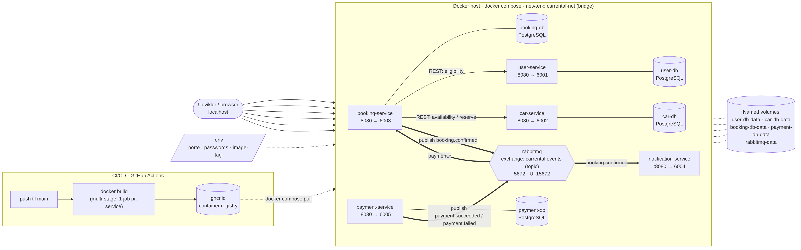

# Docker – udviklingsmiljø



## Hvad er der

| Fil | Formål |
|---|---|
| `CarRental.*Service/Dockerfile` | Multi-stage build pr. service (SDK-image bygger, lille ASP.NET-runtime-image kører, non-root) |
| `docker-compose.yml` | 5 services + 4 PostgreSQL-databaser (én pr. service) + 1 RabbitMQ, eget netværk og named volumes |
| `.env.example` → `.env` | Porte, passwords, image-tag. `.env` er git-ignored |
| `.dockerignore` | Holder `bin/`, `obj/`, `.git` osv. ude af build-context |
| `.github/workflows/docker-publish.yml` | CI/CD: bygger alle images og pusher til ghcr.io ved push til `main` |
| `docs/dev-environment.mmd/.png` | Diagram over opsætningen |

## Kom i gang

```bash
cp .env.example .env          # ret passwords
docker compose up -d --build  # byg og start alt
docker compose ps             # status
docker compose logs -f booking-service
docker compose down           # stop (tilføj -v for at slette DB-data)
```

| Service | URL |
|---|---|
| User | http://localhost:6001/swagger |
| Car | http://localhost:6002/swagger |
| Booking | http://localhost:6003/swagger |
| Notification | http://localhost:6004/swagger |
| Payment | http://localhost:6005/swagger |
| RabbitMQ UI | http://localhost:15672 (login fra `.env`) – se køer under *Queues* |

## Vigtige designvalg

- **Build context er repo-roden.** Hver Dockerfile bygger først `CarRental.Shared` til `local-nuget-feed/` inde i build-stagen, så `PackageReference` til `CarRental.Shared 1.0.0` virker præcis som lokalt. Den lokale `local-nuget-feed/` kopieres ikke ind.
- **Layer caching:** `.csproj` kopieres og restores før resten af koden, så NuGet-restore kun køres igen, når dependencies ændres.
- **HTTP i containerne (port 8080).** HTTPS bruges ikke internt i dev-miljøet. `UseHttpsRedirection()` gør ingenting, når der ikke er en HTTPS-port (giver kun en advarsel i loggen).
- **Docker DNS:** `appsettings.json` peger på `https://localhost:500x`. I compose overskrives det med miljøvariabler (`Services__CarService=http://car-service:8080` osv.), så servicenavne bruges i stedet for IP'er.
- **Databaser og broker** starter med healthchecks, og services venter på dem (`depends_on: condition: service_healthy`).

## RabbitMQ

| Event (routing key) | Publiceres af | Kø | Consumer |
|---|---|---|---|
| `payment.succeeded` | Payment | `booking-service.payment-events` | Booking → bekræfter booking |
| `payment.failed` | Payment | `booking-service.payment-events` | Booking → Failed + frigiver bil |
| `booking.confirmed` | Booking | `notification-service.booking-confirmed` | Notification → email/SMS |

- Alt publiceres til topic-exchangen `carrental.events`. Hver consumer har sin egen durable kø, så nye services kan lytte med uden at ændre afsenderen.
- Beskeder er persistente og ack'es først efter behandling: er en consumer nede, venter beskederne i køen.
- Fejler behandlingen, ender beskeden i `carrental.dead-letter` (se den i RabbitMQ-UI'et).
- Booking → User og Booking → Car er stadig REST, fordi Booking skal bruge svaret med det samme.

## Hvad mangler stadig

- Services bruger in-memory storage. Connection strings er klar som `ConnectionStrings__Default` (fx `Host=booking-db;Database=bookingdb;...`), så når I tilføjer EF Core + Npgsql, læses den med `builder.Configuration.GetConnectionString("Default")`.

## CI/CD

Workflowet kører på GitHub ved push/PR til `main`. Én job pr. service (matrix). PR'er bygges kun, mens push til `main` pusher til
`ghcr.io/<owner>/<repo>/<service>:latest` og `:<commit-sha>`. Det kræver ingen secrets (bruger `GITHUB_TOKEN`).
Sæt `IMAGE_REGISTRY` i `.env` til samme sti, hvis I vil køre de færdige images med `docker compose pull && docker compose up -d`.
