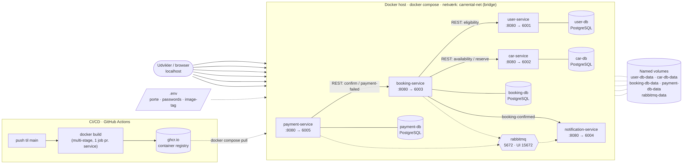

# Docker – udviklingsmiljø



## Hvad er der

| Fil | Formål |
|---|---|
| `CarRental.*Service/Dockerfile` | Multi-stage build pr. service (SDK-image bygger, lille ASP.NET-runtime-image kører, non-root) |
| `docker-compose.yml` | 5 services + 4 PostgreSQL-databaser (én pr. service) + 1 RabbitMQ, eget netværk og named volumes |
| `.env.example` → `.env` | Porte, passwords, image-tag. `.env` er git-ignored |
| `.dockerignore` | Holder `bin/`, `obj/`, `.git` osv. ude af build-context |
| `.github/workflows/docker-publish.yml` | CI/CD: bygger alle images og pusher til ghcr.io ved push til `main` |
| `docs/dev-environment.mmd/.png` | Diagram over opsætningen |

## Kom i gang

```bash
cp .env.example .env          # ret passwords
docker compose up -d --build  # byg og start alt
docker compose ps             # status
docker compose logs -f booking-service
docker compose down           # stop (tilføj -v for at slette DB-data)
```

| Service | URL |
|---|---|
| User | http://localhost:6001/swagger |
| Car | http://localhost:6002/swagger |
| Booking | http://localhost:6003/swagger |
| Notification | http://localhost:6004/swagger |
| Payment | http://localhost:6005/swagger |
| RabbitMQ UI | http://localhost:15672 (login fra `.env`) – se køer under *Queues* |

## Vigtige designvalg

- **Build context er repo-roden.** Hver Dockerfile bygger først `CarRental.Shared` til `local-nuget-feed/` inde i build-stagen, så `PackageReference` til `CarRental.Shared 1.0.0` virker præcis som lokalt. Den lokale `local-nuget-feed/` kopieres ikke ind.
- **Layer caching:** `.csproj` kopieres og restores før resten af koden, så NuGet-restore kun køres igen, når dependencies ændres.
- **HTTP i containerne (port 8080).** HTTPS bruges ikke internt i dev-miljøet. `UseHttpsRedirection()` gør ingenting, når der ikke er en HTTPS-port (giver kun en advarsel i loggen).
- **Docker DNS:** `appsettings.json` peger på `https://localhost:500x`. I compose overskrives det med miljøvariabler (`Services__CarService=http://car-service:8080` osv.), så servicenavne bruges i stedet for IP'er.
- **Databaser og broker** starter med healthchecks, og services venter på dem (`depends_on: condition: service_healthy`).

## RabbitMQ

| Event (routing key) | Publiceres af | Kø | Consumer |
|---|---|---|---|
| `payment.succeeded` | Payment | `booking-service.payment-events` | Booking → bekræfter booking |
| `payment.failed` | Payment | `booking-service.payment-events` | Booking → Failed + frigiver bil |
| `booking.confirmed` | Booking | `notification-service.booking-confirmed` | Notification → email/SMS |

- Alt publiceres til topic-exchangen `carrental.events`. Hver consumer har sin egen durable kø, så nye services kan lytte med uden at ændre afsenderen.
- Beskeder er persistente og ack'es først efter behandling: er en consumer nede, venter beskederne i køen.
- Fejler behandlingen, ender beskeden i `carrental.dead-letter` (se den i RabbitMQ-UI'et).
- Booking → User og Booking → Car er stadig REST, fordi Booking skal bruge svaret med det samme.

## Databaser

| Service | Database | Container | Port på host (fra Rider / DB-værktøj) |
|---|---|---|---|
| User | `userdb` | `user-db` | `localhost:5433` |
| Car | `cardb` | `car-db` | `localhost:5434` |
| Booking | `bookingdb` | `booking-db` | `localhost:5435` |
| Payment | `paymentdb` | `payment-db` | `localhost:5436` |

Login: `carrental` / `skift-mig` (fra `.env`). Ved opstart opretter hver service selv sine tabeller og, hvis `SEED_TEST_DATA=true`, testdataene nedenfor. Data ligger i named volumes og overlever `docker compose down`.

**Nulstil alt (fx efter ændring i en model-klasse):**
```bash
docker compose down -v      # sletter også databaserne
docker compose up -d --build
```

**Kør én service fra Rider mod resten i Docker:** stop den i Docker (`docker compose stop car-service`) og start den fra Rider. `appsettings.json` peger allerede på databasen via host-porten ovenfor og på RabbitMQ via `localhost:5672`.

## Testdata

Alle id'er er tal i kronologisk rækkefølge, og alle brugere har kodeordet **`Test123!`**. Nye rækker oprettet via API'et fortsætter fra næste ledige id (fx kunde 13, bil 11).

**Brugere** (User Service)

| Id | Navn | Email | Rolle | Til test af |
|---|---|---|---|---|
| 1 | Lars Pedersen | lars@test.dk | Customer | Må leje (har en afsluttet og en fejlet booking) |
| 2 | Mette Hansen | mette@test.dk | Customer | Må leje |
| 3 | Ahmed Khan | ahmed@test.dk | Customer | Må leje |
| 4 | Sofie Andersen | sofie@test.dk | Customer | Må leje (har bil ude nu) |
| 5 | Rasmus Kristensen | rasmus@test.dk | Customer | Må leje |
| 6 | Fatima Ali | fatima@test.dk | Customer | Må leje |
| 7 | Jonas Møller | jonas@test.dk | Customer | Må leje |
| 8 | Ida Christensen | ida@test.dk | Customer | Må leje |
| 9 | Emil Poulsen | emil@test.dk | Customer | **Afvises:** under 21 |
| 10 | Nanna Holm | nanna@test.dk | Customer | **Afvises:** udløbet kørekort |
| 11 | Admin Bruger | admin@carrental.dk | Admin | |
| 12 | Jonas Medarbejder | employee@carrental.dk | Employee | |

**Biler** (Car Service) – alle i København

| Id | Bil | Type | Pladser | Pris/dag | Status |
|---|---|---|---|---|---|
| 1 | Peugeot 208 | Economy | 5 | 279 | Available |
| 2 | Fiat 500 | Economy | 4 | 249 | Available |
| 3 | Toyota Corolla | Compact | 5 | 379 | RentedOut (booking 5) |
| 4 | Hyundai i30 | Compact | 5 | 359 | Reserved (booking 7) |
| 5 | Audi Q5 | SUV | 5 | 749 | Reserved (booking 8) |
| 6 | Toyota RAV4 Hybrid | SUV | 5 | 649 | Available |
| 7 | BMW 5 Series | Luxury | 5 | 1099 | Available |
| 8 | Polestar 2 | Luxury | 5 | 949 | **InMaintenance** (kan ikke bookes) |
| 9 | Mercedes-Benz Vito Tourer | Van | 8 | 849 | Available |
| 10 | Volkswagen Caravelle | Van | 9 | 899 | Available |

**Bookinger** (Booking Service) og **betalinger** (Payment Service – betaling *n* hører til booking *n*)

| Id | Kunde | Bil | Periode | Status | Betaling |
|---|---|---|---|---|---|
| 1 | 1 Lars | 1 Peugeot | 5.–8. sep. | Completed | 837 kr, Succeeded |
| 2 | 2 Mette | 6 RAV4 | 12.–19. sep. | Completed | 4.543 kr, Succeeded |
| 3 | 3 Ahmed | 9 Vito | 2.–4. okt. | Completed | 1.698 kr, Succeeded |
| 4 | 7 Jonas | 7 BMW | 5.–7. nov. | CancelledFree | 2.198 kr, Refunded |
| 5 | 4 Sofie | 3 Corolla | 14.–20. nov. | PickedUp | 2.274 kr, Succeeded |
| 6 | 8 Ida | 10 Caravelle | 10.–12. nov. | CancelledWithFee (449,50 kr) | 1.798 kr, Refunded |
| 7 | 5 Rasmus | 4 i30 | 28. nov.–1. dec. | Confirmed | 1.077 kr, Succeeded |
| 8 | 6 Fatima | 5 Q5 | 20.–27. dec. | Confirmed | 5.243 kr, Succeeded |
| 9 | 1 Lars | 2 Fiat | 5.–6. dec. | Failed | 249 kr, Failed (Card declined) |
| 10 | 3 Ahmed | 6 RAV4 | 10.–13. dec. | Failed | 1.947 kr, Failed (Insufficient funds) |

**Hurtig test i Swagger:** `POST /api/booking` (port 6003) med `{"customerId": 1, "carId": 7, "startDate": "2027-01-10T10:00:00", "endDate": "2027-01-12T10:00:00"}`, og betal med `POST /api/payment` (port 6005) med `{"bookingId": <id fra svaret>, "amount": 2198}`. Prøv kunde 9 eller 10, eller bil 8, for at se reglerne afvise.

## CI/CD

Workflowet kører på GitHub ved push/PR til `main`. Én job pr. service (matrix). PR'er bygges kun, mens push til `main` pusher til
`ghcr.io/<owner>/<repo>/<service>:latest` og `:<commit-sha>`. Det kræver ingen secrets (bruger `GITHUB_TOKEN`).
Sæt `IMAGE_REGISTRY` i `.env` til samme sti, hvis I vil køre de færdige images med `docker compose pull && docker compose up -d`.
